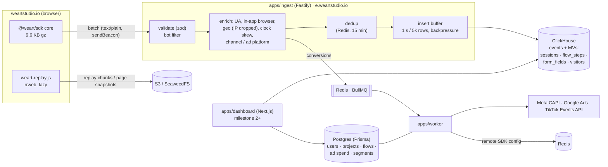

# weart analytics

First-party product analytics for **weartstudio.io**: see everything people do after clicking an
ad (Meta, Instagram, Google, TikTok), step by step through `/onboarding-3`, and exactly where and
why they drop off.

> **Status: milestone 1 of 10 is done**: SDK, ingestion, schema, conversion forwarding (dry-run)
> and seed data. The dashboard (`apps/dashboard`) starts in milestone 2. See
> [docs/PLAN.md](docs/PLAN.md) for the full plan and milestones.

## Architecture



| Path | What it is |
|---|---|
| `packages/sdk` | Browser SDK: identity, sessions, attribution, consent, autocapture (pageviews, time on page, clicks, rage/dead clicks, scroll, forms, errors, network, web vitals), flow helper, experiments, revenue, replay + page snapshots |
| `packages/shared` | Wire format (zod), event names, channel classification, in-app browser + bot detection, flow definitions |
| `packages/queries` | ClickHouse client, migrations, row types (and in milestone 2+, the typed query layer) |
| `packages/db` | Prisma schema (Postgres), password hashing, credential encryption |
| `apps/ingest` | Fastify ingestion API: `/v1/batch`, `/v1/replay`, `/v1/snapshot`, `/v1/config`, `/sdk/*.js`, `/health` |
| `apps/worker` | BullMQ worker: conversion forwarding (Meta CAPI, Google Ads, TikTok), publishes SDK remote config. Later: ad imports, anomalies, alerts, reports |
| `tools/seed` | Generates 60 days of realistic ad traffic (about 1.5M events, 78k sessions) plus ad spend |
| `examples/onboarding-3` | Reference integration of the SDK on an onboarding flow (also used by the e2e tests) |
| `e2e` | Playwright: real browser → SDK → ingest → ClickHouse / worker |

## Quick start

Requirements: Node 22+, pnpm 10, Docker.

```bash
cp .env.example .env
pnpm install
pnpm infra:up                         # ClickHouse, Postgres, Redis, S3 (SeaweedFS)
pnpm db:migrate                       # ClickHouse migrations + Prisma migrations
pnpm --filter @weart/sdk build        # builds dist/weart.js (+ size check)
pnpm seed                             # ~1.5M events, ad spend, admin login
pnpm --filter @weart/ingest start     # http://localhost:4318
pnpm --filter @weart/worker start
```

Seeded login (for the dashboard from milestone 2): `admin@weartstudio.io` / `weart-demo-2026`.

Try the reference onboarding page locally:

```bash
python3 -m http.server 5173 --directory examples
open "http://localhost:5173/onboarding-3/?utm_source=instagram&utm_medium=paid_social&utm_campaign=test&fbclid=abc"
```

### Tests

```bash
pnpm test        # Vitest: shared, SDK (jsdom), ingest, worker
pnpm size        # SDK core must stay under 10 KB gzipped
pnpm e2e         # Playwright; needs infra + ingest + worker running and the seed applied
```

## Installing on weartstudio.io

1. **Ingest on a first-party subdomain.** Create `e.weartstudio.io` (a CNAME or A record to the
   ingest service, behind TLS). The ingest server then sets the visitor cookie itself, which
   avoids Safari ITP's 7-day cap on JavaScript cookies and most ad-blocker lists. Set
   `INGEST_COOKIE_DOMAIN=.weartstudio.io` and `INGEST_ALLOWED_ORIGINS=https://weartstudio.io,https://www.weartstudio.io`.
2. **Add the SDK.** Use the script tag on marketing pages and `@weart/sdk` in the app. See
   [docs/ONBOARDING_3_INTEGRATION.md](docs/ONBOARDING_3_INTEGRATION.md).
3. **Tag the ads** with the URL templates in [docs/ADS_URL_TEMPLATES.md](docs/ADS_URL_TEMPLATES.md).
4. **Connect consent.** Call `weart.consent('granted' | 'denied')` from your cookie banner.

## Event spec

All events share: `event_id` (UUIDv7, dedup key), `anonymous_id`, `session_id`, `user_id`, page
(`url`, `path`, `title`), session attribution (UTM, campaign/ad set/ad/creative IDs, click ID,
channel), first-touch attribution, device and geo.

| Event | Source | Typed columns / properties |
|---|---|---|
| `$pageview` | auto (load + History API) | `referrer`, `pv_id` |
| `$pageleave` | auto (route change, tab hidden, unload) | `duration_ms` = active, `idle_ms`, `value` = max scroll %, `visible_ms`. Increments since the last report |
| `$scroll_depth` | auto | `value` = 25/50/75/100 |
| `$click` / `$rage_click` / `$dead_click` | auto | `element_selector`, `element_text`, `x`, `y`, `page_x`, `page_y` |
| `$form_field_focus` / `$form_field_blur` | auto | `field_name`, `duration_ms`, `value` = hesitation ms, `filled`, `refill`, `length_bucket` |
| `$form_field_error` | auto (`invalid`, `aria-invalid`) or `weart.fieldError()` | `field_name`, `error_message` |
| `$form_submit` / `$form_abandon` | auto | `last_field`, `fields_touched` |
| `$error` / `$network_error` | auto | `error_message`, stack, request URL without query, status |
| `$web_vital` | auto | `metric` (LCP, INP, CLS, TTFB, FCP), `value` |
| `$identify` | `weart.identify()` | hashed traits |
| `$exposure` | `weart.getVariant()` | `experiment`, `variant` (also in the `experiments` map on all later events) |
| `$consent` | `weart.consent()` | `state` |
| `onboarding_*` | flow helper | see [onboarding guide](docs/ONBOARDING_3_INTEGRATION.md) |
| `purchase` | `weart.revenue()` | `revenue`, `currency`, `order_id` |
| `sign_up` | manual | `email_hash` |

## Data model

ClickHouse (`packages/queries/migrations`):

- `events`: raw log, `ReplacingMergeTree` on `event_id`, partitioned by month, TTL 395 days, sorted
  by `(project_id, date, event, anonymous_id)`.
- `sessions`: one row per session (AggregatingMergeTree via MV) holding attribution, device,
  entry/exit page, active time, max onboarding step, revenue, frustration counters. All report
  filters run against it.
- `flow_steps`: one row per (session, step) holding entered/completed time, duration, clicks,
  rage/dead clicks, errors, backs and the last focused field. This powers the onboarding funnel
  and drill-down without scanning raw events.
- `form_fields`: one row per (session, page, field) holding focus count, time, hesitation, refills,
  errors and the last error.
- `visitors`: one row per browser, with first/last seen and first touch.
- `identities`: anonymous_id → user_id (merges pre-signup history).
- `replay_chunks`, `page_snapshots`: indexes of objects in S3.
- `ingest_stats`: per-minute accepted / dropped (bot, duplicate, invalid) counts.

Postgres (`packages/db/prisma/schema.prisma`): workspaces, users and roles
(owner/admin/analyst/viewer), sessions, invites, projects (consent mode, retention, sampling,
whitelisted fields), flow definitions, ad spend + imports, segments, funnels, conversion
destinations + logs, share links, audit log.

## Decisions and deviations (milestone 1)

| Decision | Why |
|---|---|
| **SeaweedFS instead of MinIO** for local S3 | MinIO no longer publishes images to Docker Hub/quay. SeaweedFS is Apache-2.0 and S3-compatible. Production uses any S3 API (AWS S3, R2) through the same `S3_*` env vars |
| **scrypt** (Node built-in) for passwords, not argon2 | Equally memory-hard and needs no native addon, so Docker images and CI builds stay simple |
| **`text/plain` batches** | Keeps SDK requests CORS "simple requests": no preflight round trip per flush, which matters on slow mobile networks in in-app browsers |
| **Typed hot columns + JSON `properties`** | Common report paths (step, duration, field, selector, revenue) never parse JSON |
| **Pre-aggregation through materialized views** (`sessions`, `flow_steps`, `form_fields`) | Dashboard queries touch ~10⁴–10⁵ rows instead of 10⁶+ events, which keeps pages under the 1.5 s target |
| **Dedup in Redis** (`SET NX`, 15 min) + `ReplacingMergeTree` | Exact across ingest replicas before MVs aggregate, with merge-time dedup as a safety net |
| **Clock-skew correction** | Event time = client time + (server receive − client send), because mobile clocks are often wrong |
| **SPA step changes are not abandonment** | `onboarding_abandoned` / `$form_abandon` fire only on real unload. Drop-off is also derived server-side from `flow_steps`, because mobile tabs often never unload |
| **rrweb 2.1.1 `@rrweb/record`** | Stable, record-only build. Loaded lazily, only for sampled sessions |
| **Conversion forwarding defaults to dry-run** | Destinations log the exact payload until credentials are set and dry-run is switched off. IP forwarding is opt-in (`FORWARD_CLIENT_IP`) |

## Docs

- [Architecture plan, schema, screens, milestones](docs/PLAN.md)
- [Onboarding-3 integration guide](docs/ONBOARDING_3_INTEGRATION.md)
- [Ad URL templates](docs/ADS_URL_TEMPLATES.md)
- [Privacy and data handling](docs/PRIVACY.md)
- [Вебвизор: записи сессий, тепловые карты, аналитика форм](docs/SESSION_REPLAY.md)
